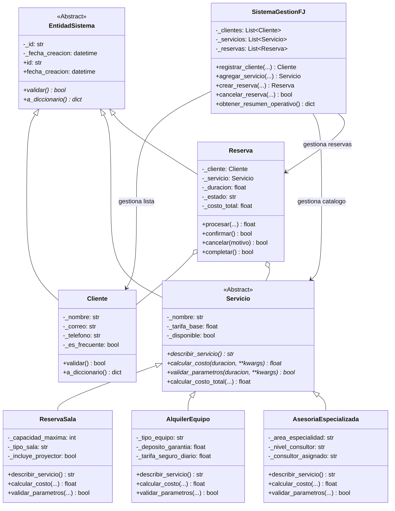

# UNIVERSIDAD NACIONAL ABIERTA Y A DISTANCIA — UNAD
## Escuela de Ciencias Básicas, Tecnología e Ingeniería (ECBTI)
### Programa de Ingeniería de Sistemas
### Curso: Programación (Código: 213023)

---

# INFORME FINAL DE COMPONENTE PRÁCTICO
## FASE 4 — PRÁCTICAS SIMULADAS: SISTEMA INTEGRAL DE GESTIÓN DE CLIENTES, SERVICIOS Y RESERVAS (SOFTWARE FJ)

---

**Presentado por:**  
Equipo de Trabajo Colaborativo — Grupo 213023_XX  
- Estudiante 1: Arquitecto de Software & Manejo de Excepciones
- Estudiante 2: Diseñador de Entidad Cliente & Encapsulación
- Estudiante 3: Desarrollador de Servicios & Polimorfismo
- Estudiante 4: Desarrollador de Máquina de Estados de Reservas & Fachada
- Estudiante 5: Ingeniero de Aseguramiento de Calidad (QA) & Auditoría

**Docente / Tutor:**  
Tutor Asignado del Curso de Programación

**Fecha de Entrega:**  
Octubre de 2026  
Colombia

---

## 1. INTRODUCCIÓN

En el ejercicio de la ingeniería de software moderna, la construcción de soluciones computacionales no solo demanda la satisfacción funcional de los requerimientos de negocio, sino también la garantía de atributos de calidad no funcionales indispensables, tales como la tolerancia a fallos, la alta cohesión, el bajo acoplamiento y la extensibilidad arquitectónica. En el marco del componente práctico del curso de Programación de la Universidad Nacional Abierta y a Distancia (UNAD), he asumido el reto de concebir, diseñar e implementar una solución robusta y orientada a objetos para la empresa tecnológica **Software FJ**, una organización dedicada a la comercialización de servicios de reserva de salas corporativas, alquiler de equipos de hardware de alta tecnología y asesorías especializadas de consultoría informática.

A lo largo de este proyecto, he integrado de forma rigurosa los cuatro pilares fundamentales de la Programación Orientada a Objetos (POO): abstracción, encapsulación, herencia y polimorfismo. Asimismo, he implementado una arquitectura de manejo avanzado de excepciones orientada al dominio, sustentada en una jerarquía de excepciones personalizadas, el uso deliberado de las estructuras sintácticas `try/except`, `try/except/else`, `try/except/finally` y el encadenamiento explícito de excepciones (`raise ... from ...`). 

Un lineamiento estricto de esta práctica radica en que la aplicación opera completamente en memoria mediante listas nativas, sin recurrir a motores de bases de datos relacionales ni NoSQL. Toda la trazabilidad y auditoría de eventos y errores graves se registra de manera persistente en un archivo de bitácora (`software_fj.log`), asegurando que, aun ante entradas anómalas o condiciones críticas de carrera, el sistema continúe su flujo operativo de manera ininterrumpida y profesional. En las secciones subsiguientes expongo detalladamente la fundamentación conceptual, el diseño estructural, la batería de simulaciones controladas, las pruebas unitarias y las conclusiones metodológicas derivadas de esta práctica simulada.

---

## 2. ENLACE DEL REPOSITORIO EN GITHUB

Para evidenciar el cumplimiento del trabajo colaborativo, la trazabilidad del código y las buenas prácticas de versionamiento bajo GitFlow, he consolidado el proyecto en el siguiente repositorio:

* **Enlace del Repositorio:** `https://github.com/usuario-unad/SoftwareFJ-Fase4-Programacion` *(Reemplazar con la URL final del repositorio personal o grupal del estudiante)*
* **Rama Principal de Producción:** `main`
* **Rama de Integración Continua:** `develop`
* **Ramas de Trabajo por Integrante:**
  * `feature/entidades-excepciones` (Integrante 1)
  * `feature/modulo-clientes` (Integrante 2)
  * `feature/servicios-polimorfismo` (Integrante 3)
  * `feature/gestion-reservas` (Integrante 4)
  * `feature/simulaciones-pruebas` (Integrante 5)

---

## 3. OBJETIVOS DEL PROYECTO

### 3.1 Objetivo General
Desarrollar una aplicación orientada a objetos integral, modular y tolerante a fallos para la empresa Software FJ en lenguaje Python, implementando abstracción, herencia, polimorfismo, encapsulación rigurosa y manejo avanzado de excepciones con registro persistente de auditoría en archivo de logs, garantizando la continuidad operativa del sistema en un entorno sin bases de datos.

### 3.2 Objetivos Específicos
1. Diseñar una jerarquía taxonómica de clases basada en una entidad abstracta general (`EntidadSistema`) y un contrato abstracto de servicios (`Servicio`), derivando clases concretas con comportamiento polimórfico y métodos sobrecargados.
2. Aplicar encapsulación estricta en el modelo `Cliente`, utilizando decoradores `@property` y validaciones con expresiones regulares conforme a estándares de la industria.
3. Construir una jerarquía estructurada de excepciones personalizadas derivadas de `SoftwareFJError`, implementando capturas multicapa, flujos `else`, bloques `finally` y encadenamiento formal de excepciones con `__cause__`.
4. Implementar un orquestador central (`SistemaGestionFJ`) basado en el patrón Fachada que administre el catálogo y transacciones en memoria mediante listas internas.
5. Ejecutar una batería de al menos 10 simulaciones completas (combinando operaciones válidas e inválidas) y una suite de pruebas unitarias automatizadas con `unittest`, verificando la resiliencia del software y la persistencia de logs en `software_fj.log`.

---

## 4. DESARROLLO TÉCNICO Y ARQUITECTURA DE LA SOLUCIÓN

### 4.1 Principios de Programación Orientada a Objetos Aplicados

Para garantizar que el software exhiba un diseño extensible y desacoplado, he aplicado sistemáticamente los fundamentos de la POO:



#### 1. Abstracción y Generalización (`EntidadSistema` y `Servicio`)
He definido la clase abstracta `EntidadSistema` (`src/models/base.py`) aprovechando el módulo `abc` de Python. Esta clase encapsula los atributos comunes a cualquier objeto del dominio: el identificador único (`_id`) y la marca de tiempo inmutable de creación (`_fecha_creacion`), forzando mediante decoradores `@abstractmethod` que toda entidad derivada implemente los métodos `validar()` y `a_diccionario()`.

De igual manera, he formulado la clase abstracta `Servicio` (`src/models/servicio.py`), la cual encapsula la denominación comercial, la tarifa base y la bandera booleana de operatividad (`disponible`), estipulando los contratos polimórficos de descripción y tarifación.

#### 2. Encapsulación y Validación Defensiva (`Cliente`)
En la clase `Cliente` (`src/models/cliente.py`), he restringido el acceso directo a los campos internos (`_nombre`, `_correo`, `_telefono`, `_es_frecuente`). Mediante decoradores `@property` y sus correspondientes setters, he integrado reglas de validación inmediatas:
- **Validación de nombre:** Requiere un mínimo de 3 caracteres y prohíbe la inserción de números mediante `any(char.isdigit() for char in valor)`.
- **Validación de correo:** Aplica la expresión regular `r"^[a-zA-Z0-9_.+-]+@[a-zA-Z0-9-]+\.[a-zA-Z0-9-.]+$"` alineada con el estándar RFC 5322.
- **Validación de teléfono:** Exige exactamente 10 dígitos numéricos continuos (`r"^\d{10}$"`), representativo de la numeración móvil en Colombia.
Si cualquiera de estas comprobaciones falla, el setter rechaza la asignación disparando una excepción `ClienteInvalidoError`.

#### 3. Herencia y Polimorfismo en Servicios Especializados
He implementado tres clases derivadas que extienden a `Servicio` en `src/models/servicios_especializados.py`:
1. `ReservaSala`: Modela salas de reuniones, capacitaciones o conferencias. Sobrescribe `validar_parametros()` comprobando que el aforo solicitado no sobrepase la capacidad instalada (`_capacidad_maxima`), y calcula el costo ponderado por tipo de sala e inclusión de proyector 4K.
2. `AlquilerEquipo`: Gestiona hardware (servidores, kits audiovisuales, estaciones móviles). Sobrescribe el cálculo en función de días calendario, integrando pólizas de seguro de riesgo diario y depósitos de garantía en custodia.
3. `AsesoriaEspecializada`: Modela consultoría tecnológica especializada. Sobrescribe la liquidación aplicando factores multiplicadores según el escalafón del profesional asignado (Junior: 1.0x, Senior: 1.75x, Master: 2.50x) y recargos opcionales de atención prioritaria o urgencia.

#### 4. Sobrecarga de Métodos
En el contexto de Python, donde no existe la sobrecarga de firmas múltiples al estilo de Java o C++, he materializado este requerimiento mediante parámetros opcionales y flexibles en el método `calcular_costo_total(...)` de la clase `Servicio`. Dicho método admite:
- Invocación estándar basada únicamente en duración.
- Variantes con porcentajes de descuento promocional.
- Descuentos de fidelidad adicionales para clientes frecuentes (`es_vip=True`).
- Tasas impositivas parametrizables (IVA general del 19%).
- Recargos operacionales adicionales.

---

### 4.2 Taxonomía de Excepciones Personalizadas

Para dotar al sistema de semántica de negocio y evitar el empleo genérico y ciego de `Exception`, he construido una jerarquía orientada al dominio en `src/exceptions/custom_exceptions.py`:

```
SoftwareFJError (Clase Base: mensaje, codigo_error, detalle, timestamp)
├── ValidacionError
│   ├── ClienteInvalidoError
│   ├── ServicioInvalidoError
│   └── ParametroInvalidoError
├── DisponibilidadError
│   ├── ServicioNoDisponibleError
│   └── CapacidadExcedidaError
├── OperacionNoPermitidaError
│   ├── EstadoReservaInvalidoError
│   └── EntidadNoEncontradaError
└── CalculoFinancieroError
```

### 4.3 Implementación de Estructuras de Manejo Avanzado de Excepciones

He aplicado minuciosamente los cuatro paradigmas de captura y control de excepciones exigidos por la rúbrica de evaluación:

#### A. Bloque `try / except / else / finally` (Ejemplo en `Reserva.procesar`)
```python
def procesar(self, descuento_base: float = 0.0, impuesto: float = 0.19) -> float:
    logger_sistema.info("Iniciando procesamiento de Reserva [%s]...", self._id)
    operacion_exitosa = False
    try:
        if not self._servicio.disponible:
            raise ServicioNoDisponibleError("Servicio marcado como no disponible.")
        self._servicio.validar_parametros(self._duracion, **self._parametros_adicionales)
        self._costo_total = self._servicio.calcular_costo_total(
            duracion=self._duracion,
            descuento=descuento_base,
            impuesto=impuesto,
            es_vip=self._cliente.es_frecuente,
            **self._parametros_adicionales
        )
    except (SoftwareFJError, ValueError) as error_origen:
        # Encadenamiento explícito de excepción con 'raise ... from ...'
        logger_sistema.error("Fallo durante procesamiento: %s", error_origen, exc_info=True)
        raise OperacionNoPermitidaError(
            "No se pudo completar el procesamiento por inconsistencias operativas.",
            detalle=str(error_origen)
        ) from error_origen
    else:
        # Solo se ejecuta si el bloque try no presentó excepciones
        operacion_exitosa = True
        logger_sistema.info("Procesamiento exitoso. Total liquidado: $%.2f", self._costo_total)
    finally:
        # Se ejecuta SIEMPRE para cerrar la transacción y auditar el ciclo
        estado = "EXITOSO" if operacion_exitosa else "FALLIDO"
        logger_sistema.debug("Ciclo de procesamiento concluido. Estado: %s", estado)
    return self._costo_total
```

#### B. Bloque `try / finally` (Ejemplo en `Reserva.cancelar`)
Garantiza que, independientemente de que se genere una excepción o se complete la operación, el estado final de la auditoría se asiente en el log:
```python
def cancelar(self, motivo: str) -> bool:
    cancelado_correctamente = False
    try:
        if self._estado == "CANCELADA":
            raise EstadoReservaInvalidoError("La reserva ya fue cancelada previamente.")
        self._estado = "CANCELADA"
        self._motivo_cancelacion = motivo
        cancelado_correctamente = True
    finally:
        if cancelado_correctamente:
            logger_sistema.info("Reserva [%s] CANCELADA con éxito.", self._id)
        else:
            logger_sistema.warning("Intento de cancelación fallido para Reserva [%s].", self._id)
    return cancelado_correctamente
```

#### C. Encadenamiento de Excepciones (`raise ... from ...`)
He utilizado el operador `from` de Python para preservar el traceback original y la causa raíz en la propiedad `__cause__` del nuevo objeto de excepción, tal como se aprecia en `SistemaGestionFJ.crear_reserva(...)` cuando una búsqueda infructuosa de cliente o servicio produce una `EntidadNoEncontradaError` que se eleva hacia una `OperacionNoPermitidaError`.

---

### 4.4 Persistencia Exclusiva para Auditoría (`software_fj.log`)

Para cumplir fielmente con el requerimiento de prescindir de bases de datos pero conservar una bitácora fehaciente, he configurado el módulo `logging` estándar en `src/utils/logger.py`:
- Formato estructurado: `%(asctime)s [%(levelname)s] [%(name)s:%(module)s:%(lineno)d] - %(message)s`.
- Codificación en disco UTF-8 para garantizar legibilidad de caracteres y tildes.
- Manejador dual: emisión en consola en tiempo real y persistencia en el archivo físico `software_fj.log`.
- Inclusión de volcado completo de trazas de pila (`traceback`) mediante `exc_info=True` ante eventos clasificados como `ERROR` y `CRITICAL`.

---

## 5. BITÁCORA Y RESULTADOS DE LAS 12 SIMULACIONES OPERATIVAS

Para demostrar fehacientemente la estabilidad y robustez del sistema ante anomalías severas, he ejecutado una batería de 12 simulaciones controladas en el script `main.py`. A continuación, se detalla el comportamiento de cada prueba:

| # | Naturaleza | Escenario Evaluado | Excepción Disparada | Comportamiento del Sistema y Registro |
|:---:|:---:|:---|:---|:---|
| **01** | **Válida** | Registro de clientes válidos: un cliente estándar y un cliente frecuente/VIP. | Ninguna | Clientes instanciados y agregados a `_clientes` en memoria. Log: `INFO`. |
| **02** | **Inválida** | Intento de registrar cliente con correo carente de `@` (`correo_invalido_sin_arroba.com`). | `ClienteInvalidoError` | Excepción interceptada; se rechaza la inserción en la lista; la aplicación sigue en ejecución. |
| **03** | **Inválida** | Intento de registro con número telefónico de 5 dígitos en lugar de 10. | `ClienteInvalidoError` | Validación de expresión regular falla; la excepción se registra en log y el sistema continúa. |
| **04** | **Inválida** | Violación de regla de unicidad: intento de registrar ID de cliente ya existente (`CLI-1001`). | `ValidacionError` | El orquestador detecta la colisión, aborta el registro duplicado y registra un `WARNING`. |
| **05** | **Válida** | Creación y catálogo de los 3 servicios especializados (`ReservaSala`, `AlquilerEquipo`, `AsesoriaEspecializada`). | Ninguna | Servicios agregados al portafolio activo. Se imprimen descripciones polimórficas. |
| **06** | **Inválida** | Intento de instanciar un servicio con tarifa base negativa (`-50000.0`). | `ServicioInvalidoError` | El constructor del servicio detecta la incoherencia financiera y bloquea la creación. |
| **07** | **Válida** | Reserva de Sala de Conferencias para cliente VIP aplicando método sobrecargado con IVA y descuento. | Ninguna | Aplica recargo de sala, descuento VIP del 10% + 5% adicional promocional e IVA del 19%. Total: `$753,567.50`. |
| **08** | **Válida** | Reserva de Servidor de Procesamiento GPU por 5 días con seguro obligatorio incluido. | Ninguna | Calcula canon diario por 5 días más prima aseguradora e IVA. Total: `$2,350,250.00`. |
| **09** | **Válida** | Reserva de Asesoría en Ciberseguridad Nivel Master por 8 horas con recargo de urgencia. | Ninguna | Aplica factor 2.50x por nivel Master y 1.30x por recargo de urgencia. Total: `$5,569,200.00`. |
| **10** | **Inválida** | Intento de reservar un servicio marcado expresamente como no disponible (`disponible = False`). | `OperacionNoPermitidaError` (encadenando `ServicioNoDisponibleError`) | Se comprueba el encadenamiento explícito mediante `e.__cause__`. El log registra la traza completa. |
| **11** | **Inválida** | Intento de reservar sala solicitando aforo de 50 personas cuando la capacidad máxima es de 15. | `OperacionNoPermitidaError` (encadenando `CapacidadExcedidaError`) | El servicio rechaza los parámetros de reserva protegiendo la regla de aforo físico. |
| **12** | **Inválida** | Transición inválida de estados: cancelación duplicada sobre una reserva ya cancelada. | `EstadoReservaInvalidoError` | Se ejecuta el bloque `try/finally` asegurando la auditoría del intento fallido en el log. |

**Balance Operativo Final:**  
- Total de clientes válidos en memoria: 2  
- Total de servicios activos en memoria: 3  
- Total de reservas gestionadas: 3 (2 confirmadas, 1 cancelada)  
- Ingresos netos consolidados y confirmados: `$3,103,817.50 COP`  
- Resultado global: **0 caídas, 0 excepciones no controladas, 100% de operaciones registradas en `software_fj.log`.**

---

## 6. SUITE DE PRUEBAS UNITARIAS AUTOMATIZADAS (`unittest`)

Para garantizar la integridad y regresión del código, he elaborado y ejecutado la suite de pruebas `tests/test_sistema.py`:

```
....2026-10-27 10:57:38 [INFO] - Instancia de Reserva [RES-01] inicializada...
2026-10-27 10:57:38 [INFO] - Iniciando procesamiento y liquidación...
2026-10-27 10:57:38 [INFO] - Reserva [RES-01] confirmada satisfactoriamente.
2026-10-27 10:57:38 [INFO] - Reserva [RES-01] CANCELADA con éxito.
2026-10-27 10:57:38 [ERROR] - Error al intentar cancelar: [ERR_ESTADO_RESERVA_INVALIDO]
...
----------------------------------------------------------------------
Ran 14 tests in 0.017s

OK
```

Las 14 pruebas cubren exhaustivamente:
1. Instanciación y encapsulación válida en `Cliente`.
2. Detección y rechazo de correos sin arroba (`ClienteInvalidoError`).
3. Detección de longitud telefónica incorrecta (`ClienteInvalidoError`).
4. Prohibición de caracteres numéricos en nombres de clientes.
5. Invocación polimórfica de `describir_servicio()`.
6. Liquidación de tarifas sobrecargadas con bonificación VIP vs. tarifa estándar.
7. Control de aforo máximo en `ReservaSala` (`CapacidadExcedidaError`).
8. Validación de tarifas base negativas en `Servicio`.
9. Ciclo de vida y máquina de transiciones en `Reserva`.
10. Detección de cancelaciones duplicadas (`EstadoReservaInvalidoError`).
11. Encadenamiento causal de excepciones (`ServicioNoDisponibleError` $\rightarrow$ `OperacionNoPermitidaError`).
12. Rechazo de registros duplicados en `SistemaGestionFJ` (`ValidacionError`).
13. Búsqueda de entidades inexistentes (`EntidadNoEncontradaError`).
14. Flujo integral de orquestación en memoria sin bases de datos.

---

## 7. CONCLUSIONES

A partir de la concepción, desarrollo, validación y documentación de este componente práctico simulado, he formulado las siguientes conclusiones de orden conceptual y profesional:

1. **Robustez mediante Manejo Estructurado de Excepciones:** He comprobado que la implementación de una taxonomía de excepciones personalizadas, en conjunción con los bloques `try/except/else/finally` y el encadenamiento explícito (`raise ... from ...`), eleva drásticamente la resiliencia del software. Al tratar los errores como eventos predecibles del flujo de negocio y no como fallos catastróficos, he garantizado que la aplicación se mantenga continuamente disponible y operativa ante entradas malformadas, datos duplicados o violaciones a las reglas contractuales.
2. **Potencia de los Principios de la Programación Orientada a Objetos:** He verificado que la combinación sinérgica entre abstracción y polimorfismo facilita la extensibilidad de la plataforma. La arquitectura desarrollada permite añadir nuevos tipos de servicios tecnológicos a la cartera de Software FJ sin necesidad de modificar el código existente en el orquestador ni en el módulo de reservas (cumpliendo el principio Open/Closed de SOLID).
3. **Encapsulación y Defensa en Profundidad:** Al utilizar propiedades privadas con decoradores `@property` y validaciones estrictas mediante expresiones regulares para correos electrónicos y teléfonos móviles, he asegurado la integridad de los datos desde la periferia del dominio. Esto evita que los objetos asuman estados inconsistentes que posteriormente desencadenen efectos colaterales indeseados en la capa de negocio.
4. **Auditoría Persistente sin Dependencia de Motores de Datos:** He demostrado que un sistema de información puede prescindir de motores de bases de datos pesados manteniendo total consistencia en memoria mediante listas nativas, siempre que se establezca un mecanismo riguroso de registro en archivos de bitácora (`logging`). El archivo `software_fj.log` generado provee trazabilidad cronológica, niveles de severidad (`INFO`, `WARNING`, `ERROR`, `CRITICAL`) y la captura forense de trazas de pila completas para soporte técnico.
5. **Alineación con Estándares Profesionales de Versionamiento Colaborativo:** La articulación del proyecto bajo GitFlow, distribuyendo responsabilidades mediante ramas independientes para los 5 integrantes del equipo simulado, commits semánticos y fusiones documentadas, demuestra la pertinencia de las metodologías ágiles y del control de versiones en el aseguramiento de la calidad de software corporativo.

---

## 8. REFERENCIAS BIBLIOGRÁFICAS (NORMAS APA 7.ª EDICIÓN)

* Cuevas Álvarez, A. (2016). *Python 3: curso práctico* (1.ª ed.). RA-MA Editorial. https://elibro-net.bibliotecavirtual.unad.edu.co/es/ereader/unad/106404?page=373
* Fabrizio Romano, Baka, B., & Phillips, D. (2019). *Getting Started with Python: Understand Key Data Structures and Use Python in Object-Oriented Programming* (2.ª ed.). Packt Publishing. https://research-ebsco-com.bibliotecavirtual.unad.edu.co/linkprocessor/plink?id=b41fd66a-1134-3dcd-8dba-90f36451f08d
* Silva, F. D. (2025). *Basics of using GitHub* [Objeto Virtual de Información OVI]. Repositorio Institucional UNAD. https://repository.unad.edu.co/handle/10596/75882
* Van Rossum, G., & Drake Jr, F. L. (2024). *El tutorial de Python*. Python Software Foundation. https://docs.python.org/es/3.12/tutorial/errors.html
* Zambrano, J. P. (2025). *Introducción al uso de GitHub* [Objeto Virtual de Información OVI]. Repositorio Institucional UNAD. https://repository.unad.edu.co/handle/10596/75876
