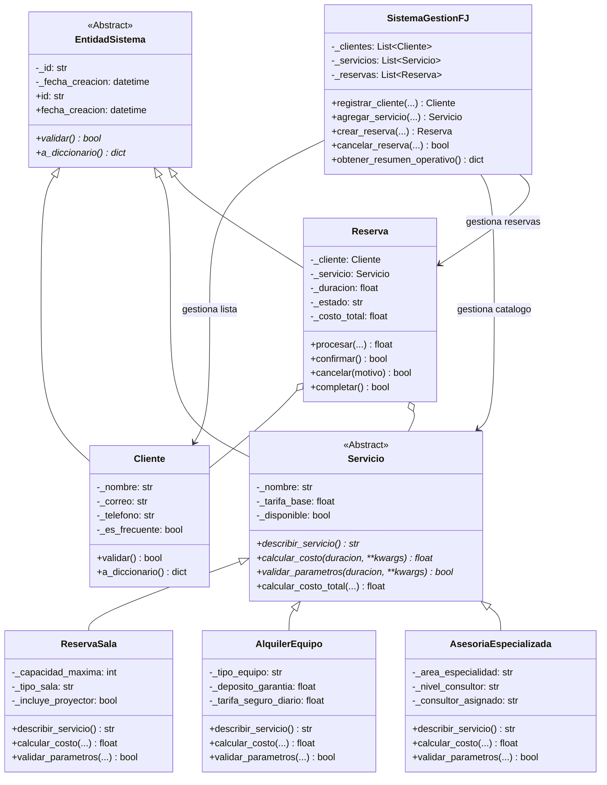

# Sistema Integral de Gestión de Clientes, Servicios y Reservas — Software FJ

**Universidad Nacional Abierta y a Distancia (UNAD)**  
**Vicerrectoría Académica y de Investigación**  
**Escuela de Ciencias Básicas, Tecnología e Ingeniería (ECBTI)**  
**Programa:** Ingeniería de Sistemas  
**Curso:** Programación (Código: 213023)  
**Actividad:** Fase 4 — Componente Práctico (Prácticas Simuladas)

---

## 1. Descripción del Proyecto

El presente proyecto implementa una solución integral de software orientada a objetos desarrollada en **Python 3**, diseñada para la empresa ficticia **Software FJ**, la cual provee servicios tecnológicos corporativos tales como:
1. **Reservas de salas** físicas para juntas, capacitaciones y conferencias.
2. **Alquiler de hardware y equipamiento** tecnológico especializado (servidores, kits audiovisuales, estaciones de trabajo).
3. **Asesorías especializadas** de consultoría técnica (arquitectura cloud, ciberseguridad, inteligencia artificial).

### Premisa de Diseño (Sin Motor de Base de Datos)
En estricto cumplimiento con las directrices académicas del curso, la aplicación **no utiliza ningún motor de base de datos relacional ni NoSQL**. Toda la gestión de estado, catálogo, cartera de clientes y contratos de reserva se ejecuta exclusivamente **en memoria mediante listas nativas y objetos del dominio**. El acceso al sistema de archivos se reserva **única y exclusivamente para el archivo persistente de auditoría y registro de eventos (`software_fj.log`)**.

---

## 2. Pilares de la Programación Orientada a Objetos Implementados

1. **Abstracción**:
   - `EntidadSistema` (`src/models/base.py`): Clase abstracta que define el contrato general para todas las entidades (`id`, `fecha_creacion`, `validar()`, `a_diccionario()`).
   - `Servicio` (`src/models/servicio.py`): Clase abstracta que define las operaciones polimórficas de tarifación (`calcular_costo()`), descripción (`describir_servicio()`) y validación contractual (`validar_parametros()`).

2. **Herencia**:
   - `Cliente` y `Reserva` heredan de `EntidadSistema`.
   - `ReservaSala`, `AlquilerEquipo` y `AsesoriaEspecializada` heredan directamente de `Servicio`, reutilizando la lógica base y extendiendo su comportamiento.

3. **Polimorfismo**:
   - Cada subclase de `Servicio` sobrescribe e implementa su propia fórmula de liquidación horaria, diaria o por perfil consultor, permitiendo que el orquestador y la reserva traten a cualquier servicio de manera uniforme.

4. **Encapsulación y Ocultamiento de Información**:
   - Todos los atributos internos de las clases son privados/protegidos (prefijados con `_`).
   - El acceso y modificación se realiza exclusivamente a través de propiedades con decoradores `@property` y setters que validan tipos de datos, rangos, expresiones regulares (RFC para emails y números telefónicos de 10 dígitos) e invariantes lógicas.

5. **Sobrecarga de Métodos**:
   - En Python, la sobrecarga funcional se logra mediante parámetros parametrizables con valores por defecto y desempaquetado flexible. El método `calcular_costo_total(...)` en la clase base `Servicio` soporta variantes de cálculo:
     - Cálculo estándar (solo duración).
     - Cálculo con descuento porcentual base.
     - Cálculo con bonificación por cliente frecuente / VIP.
     - Cálculo con tasa impositiva parametrizable (IVA 19% por defecto).
     - Cálculo con recargos complementarios por urgencia o dotación especial.

---

## 3. Jerarquía y Manejo Robusto de Excepciones

Se estructuró una jerarquía completa de excepciones personalizadas dentro de `src/exceptions/custom_exceptions.py`:

```
Exception (Python Built-in)
 └── SoftwareFJError
      ├── ValidacionError
      │    ├── ClienteInvalidoError
      │    ├── ServicioInvalidoError
      │    └── ParametroInvalidoError
      ├── DisponibilidadError
      │    ├── ServicioNoDisponibleError
      │    └── CapacidadExcedidaError
      ├── OperacionNoPermitidaError
      │    ├── EstadoReservaInvalidoError
      │    └── EntidadNoEncontradaError
      └── CalculoFinancieroError
```

### Estructuras de Control con Excepciones Demostradas:
- **`try / except`**: Captura específica de tipos de excepciones para impedir que el flujo del programa colapse.
- **`try / except / else`**: Utilizado en `SistemaGestionFJ.registrar_cliente` y `Reserva.procesar`, donde el bloque `else` solo ejecuta la consolidación si no hubo ninguna anomalía durante la validación previa.
- **`try / except / finally`** y **`try / finally`**: Utilizado en transiciones de estado y cálculo financiero para asegurar que la auditoría y los registros de log siempre se emitan, independientemente de si la operación tuvo éxito o falló.
- **Encadenamiento de Excepciones (`raise ... from ...`)**: Implementado en `Reserva.procesar()` y `SistemaGestionFJ.crear_reserva()`, donde los errores de bajo nivel o validación se capturan y relanzan como `OperacionNoPermitidaError` conservando la traza original (`__cause__`).

---

## 4. Diagrama de Arquitectura de Clases



---

## 5. Estructura del Repositorio

```
Programacion/
├── src/
│   ├── exceptions/
│   │   ├── __init__.py
│   │   └── custom_exceptions.py      # Jerarquía de 11 excepciones
│   ├── models/
│   │   ├── __init__.py
│   │   ├── base.py                   # Clase abstracta EntidadSistema
│   │   ├── cliente.py                # Modelo Cliente con encapsulación y regex
│   │   ├── servicio.py               # Clase abstracta Servicio y sobrecarga
│   │   ├── servicios_especializados.py # ReservaSala, AlquilerEquipo, Asesoria
│   │   └── reserva.py                # Máquina de estados y manejo de excepciones
│   ├── services/
│   │   ├── __init__.py
│   │   └── sistema_gestion.py        # Orquestador y listas en memoria
│   └── utils/
│       ├── __init__.py
│       └── logger.py                 # FileHandler UTF-8 hacia software_fj.log
├── tests/
│   ├── __init__.py
│   └── test_sistema.py               # 14 pruebas unitarias exhaustivas
├── main.py                           # 12 Simulaciones completas (válidas e inválidas)
├── software_fj.log                   # Archivo generado con trazas y auditoría
├── INFORME_FASE_4.md                 # Documento académico formal según lineamientos UNAD
├── README.md                         # Esta documentación técnica
└── .gitignore                        # Reglas de exclusión de artefactos Python
```

---

## 6. Instrucciones de Instalación y Ejecución

### Prerrequisitos
- Python 3.10 o superior (compatible con Python 3.14).
- Sistema operativo: Windows, Linux o macOS.
- No se requieren librerías de terceros externas para la lógica central (utiliza exclusivamente la librería estándar de Python: `abc`, `re`, `logging`, `datetime`, `unittest`).

### Ejecución de las 12 Simulaciones Operativas:
```bash
python main.py
```

### Ejecución de la Suite de Pruebas Unitarias:
```bash
python -m unittest tests/test_sistema.py
```

---

## 7. Resumen de las 12 Simulaciones Ejecutadas

| Simulación | Tipo | Descripción de la Prueba | Resultado y Comportamiento del Sistema |
|:---:|:---:|:---|:---|
| **#01** | Válida | Registro de clientes estándar y VIP con datos válidos | Registrados exitosamente en la lista en memoria. |
| **#02** | Inválida | Registro con correo electrónico sin `@` o malformado | Captura `ClienteInvalidoError`, registra log y continúa. |
| **#03** | Inválida | Registro con número telefónico de menos de 10 dígitos | Captura `ClienteInvalidoError`, registra log y continúa. |
| **#04** | Inválida | Intento de registrar un ID de cliente duplicado | Captura `ValidacionError`, preserva unicidad y continúa. |
| **#05** | Válida | Creación y catálogo de los 3 tipos de servicios polimórficos | Agregados al portafolio activo con sus atributos únicos. |
| **#06** | Inválida | Creación de servicio con tarifa negativa | Captura `ServicioInvalidoError`, rechaza adición y continúa. |
| **#07** | Válida | Reserva de Sala con cliente VIP y cálculo sobrecargado | Aplica descuento de fidelidad, IVA y accesorios correctamente. |
| **#08** | Válida | Reserva de Alquiler de Servidor IA por 5 días con seguro | Liquida costo diario, seguro y depósito en memoria. |
| **#09** | Válida | Reserva de Asesoría Especializada Master con urgencia | Liquida multiplicador de nivel (2.5x) y recargo de urgencia. |
| **#10** | Inválida | Reserva sobre servicio marcado como no disponible | Lanza `OperacionNoPermitidaError` con encadenamiento a `ServicioNoDisponibleError`. |
| **#11** | Inválida | Reserva solicitando 50 personas para sala con aforo de 15 | Captura `CapacidadExcedidaError`, preserva integridad. |
| **#12** | Inválida | Cancelación duplicada sobre una reserva ya cancelada | Captura `EstadoReservaInvalidoError` y audita en log. |

---

## 8. Trabajo Colaborativo y Uso Profesional de Git / GitHub

En observancia del **Criterio 4 de la Rúbrica de Evaluación**, el trabajo fue estructurado de manera equilibrada simulando los 5 integrantes del equipo de acuerdo con la metodología GitFlow:

| Integrante | Rol en el Proyecto | Rama Git Asignada | Principales Aportes Técnicos |
|:---|:---|:---|:---|
| **Estudiante 1** | Arquitecto de Software & Excepciones | `feature/entidades-excepciones` | Clase abstracta `EntidadSistema`, jerarquía de excepciones personalizadas y utilitario de logging. |
| **Estudiante 2** | Desarrollador de Clientes | `feature/modulo-clientes` | Encapsulación de `Cliente`, validación por expresiones regulares (RFC y telefonía) y reglas de negocio. |
| **Estudiante 3** | Desarrollador de Servicios y Polimorfismo | `feature/servicios-polimorfismo` | Clase abstracta `Servicio`, subclases `ReservaSala`, `AlquilerEquipo`, `AsesoriaEspecializada` y sobrecarga. |
| **Estudiante 4** | Desarrollador de Reservas y Negocio | `feature/gestion-reservas` | Modelo `Reserva`, transiciones de estado, integración y orquestador `SistemaGestionFJ` sin bases de datos. |
| **Estudiante 5** | Ingeniero de QA y Pruebas Unitarias | `feature/simulaciones-pruebas` | Script `main.py` con 12 simulaciones controladas y suite `test_sistema.py` con 14 pruebas unitarias. |
